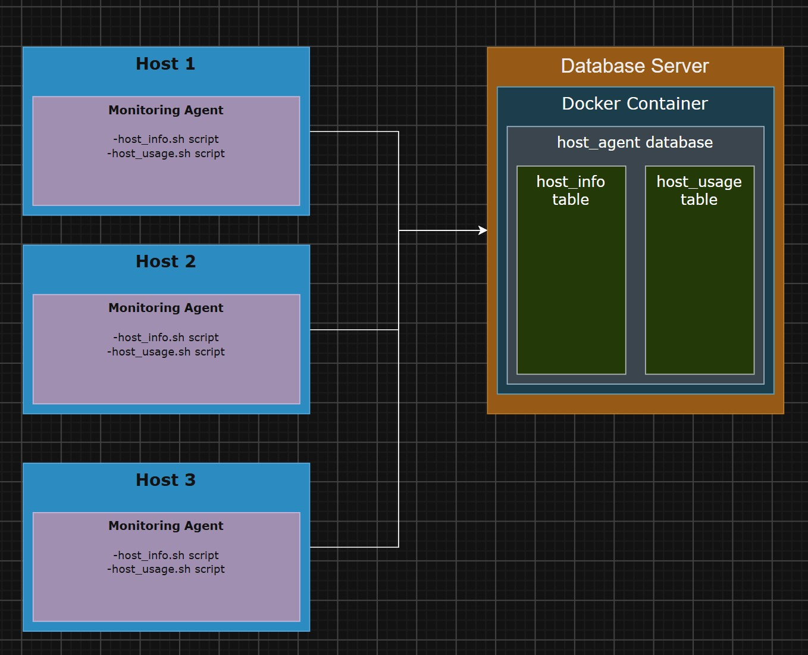

# Introduction
This project aims to run an automated hardware usage script on every member of a network and save the data to a centralized database. This system is built for a network of computers executing intensive tasks. One example could be a distributed cloud computing system, monitoring the usage and using that data to determine where to send the next task.
The technologies used include PostgreSQL, Docker, crontab and bash scripting to run the project as well as Git and GitHub throughout the development process. Each host has two scripts to run, host_info.sh and host_usage.sh. Host info is run once on boot to register the hardware with the database, then host usage is run every minute using crontab to post current timestamped usage statistics to the database.
# Quick Start
Start a psql instance
```bash
bash ./scripts/psql_docker.sh create db_username db_password
bash ./scripts/psql_docker.sh start
```
Create psql database
```
--Connect to your psql instance
psql -h localhost -U postgres -W
```
```
--Create database
postgres=# CREATE DATABASE db_name;
```
Create database tables
```
./scripts/ddl.sql`
```
Register hardware with the database
```bash
bash ./scripts/host_info.sh psql_host psql_port db_name psql_user psql_password
```
Post hardware usage to database
```bash
bash ./scripts/host_usage.sh psql_host psql_port db_name psql_user psql_password
```
Set up crontab automation
```bash
bash crontab -e
```
Within crontab editor
```
* * * * * bash filepath/host_usage.sh psql_host psql_port db_name psql_user psql_password > /tmp/host_usage.log
```


# Implementation
The project was implemented using a PostgreSQL instance within a docker container running the database to log host usage. It has a bash script to create the container and start the psql instance then bash scripts to register with the database and add usage data every minute by running a script with the crontab tool.

## Architecture

## Scripts
#### psql_docker.sh
Creates, starts and stops the docker container for the PostgreSQL instance. 
```
---Creates the container
/psql_docker.sh create db_username db_password

---Starts the created Container
/psql_docker.sh start

---Stops the running container
/psql_docker.sh stop
```
#### host_info.sh
Registers the host with the database
```
--- Adds the hosts information to the database
host_info.sh psql_host psql_port db_name psql_user psql_password
```
#### host_usage.sh
Logs the host's usage data at that point in time
```
---Logs the host's usage data at that point in time
host_usage.sh psql_host psql_port db_name psql_user psql_password 
```

#### crontab
used to run host_usage.sh every minute
```
crontab -e 

---within crontab editor
* * * * * bash filepath/host_usage.sh psql_host psql_port db_name psql_user psql_password > /tmp/host_usage.log
```
## Database Modeling
host_info


| id | hostname | cpu_number | cpu_architecture | cpu_model | cpu_mhz | L2_cache | timestamp  | total_mem |
| --- | --- | --- | --- | --- | --- | --- | --- | --- |
| 1 | noe2 | 1 | x86_64 | Intel(R) Xeon(R) CPU @ 2.30GHz | 2300 | 256 |  2019-05-29 15:01:00.000  | 601324 |

host_usage

| timestamp | host_id | memory_free | cpu_idle | cpu_kernel | disk_io | disk_available |
| --- | --- | --- | --- | --- | --- | --- |
| 2019-05-29 15:01:00.000 | 1 | 2 | 20000 | 4 | 2 | 3 |


# Test
The project was tested on a Rocky 9 VM.When run the host_usage script successfully posted its data to the database every minute. 

# Deployment
The application was deployed to GitHub and can be found at
```
https://github.com/jarviscanada/jarvis_data_eng_NicholasMuttoo
```

# Improvements
#### Array of most recent host usage reports

In a distributed systems use case, only the most recent database entry is useful to a task coordinator. Saving the most recent entry per id to a variable can save compute opposed to doing a query for the most recent timestamp per ID every time there is a new task. 

#### Single setup script

A script that combines creating and starting the docker container then running host info. If possible it can add host usage to the crontab. Currently the user has to repeat information such as the db username and password besides running 3-4 scripts. It would be easiest for the user to input that information once and let a coordinator script manage the rest. 